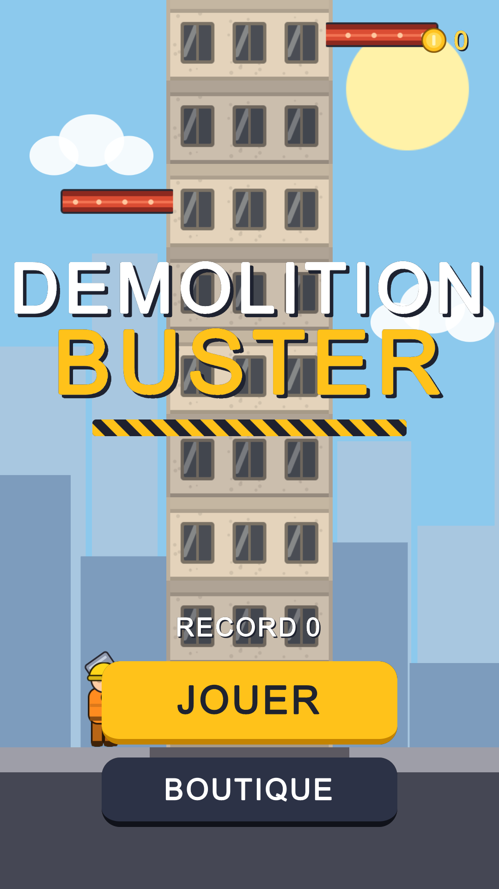
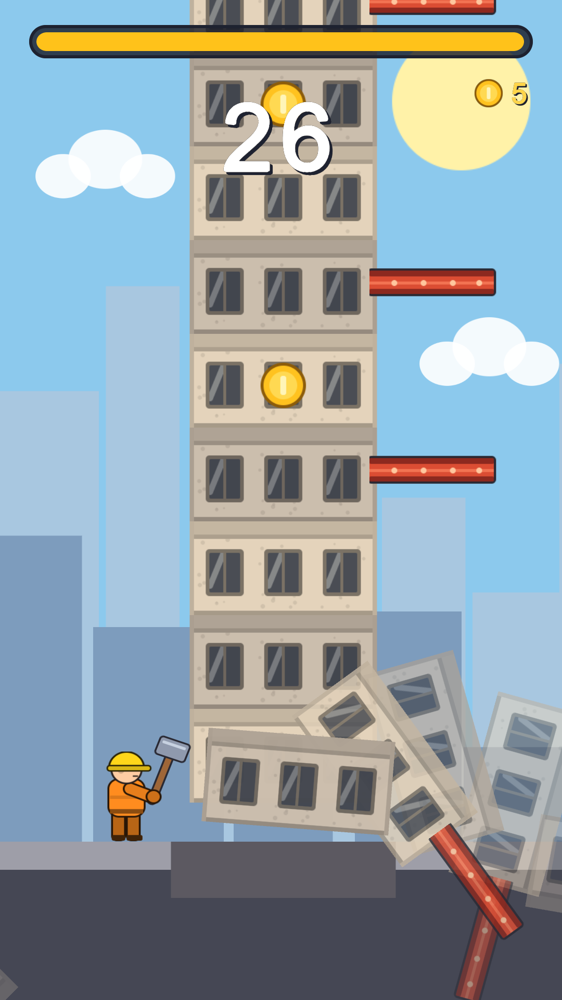
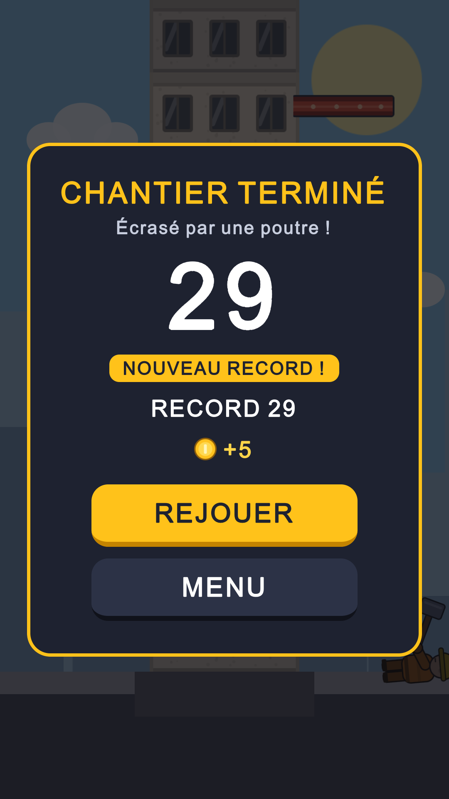
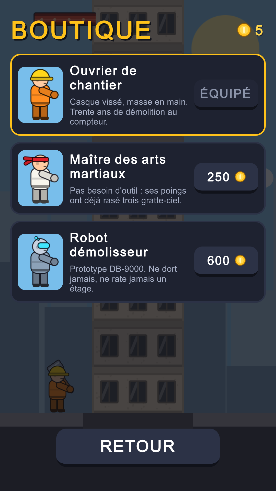

# Demolition Buster

Jeu d'arcade mobile hyper-casual en 2D portrait, développé avec **Unity 6 (6000.5)**.
Une tour infinie, deux côtés et un marteau : on tape à gauche ou à droite pour détruire l'étage du bas, en esquivant les poutres qui descendent, avant que la barre de temps ne se vide.

**Jouer dans le navigateur :** [davidbarredo.netlify.app](https://davidbarredo.netlify.app/#demolition)

**Comment il a été fait :** j'ai conçu le jeu et décidé du ressenti et des itérations ; le code a été écrit avec l'IA (Claude).

<p align="center">
  
  
  
  
</p>

## Gameplay

| Mécanique | Implémentation |
|---|---|
| Tour infinie | Buffer circulaire de N blocs : l'emplacement du bloc détruit est recyclé comme nouveau sommet (`TowerModel`). |
| Dangers | Une poutre sur l'étage du bas du côté du joueur = mort (**Blocked**). Une poutre qui descend sur lui = mort (**Crushed**). |
| Génération | Départ sans danger, écart minimal garanti entre deux poutres (la tour est toujours jouable) et probabilité de danger qui croît avec la hauteur (`RandomBlockGenerator`). |
| Pression | La barre se vide de plus en plus vite. Chaque coup rend une fraction de seconde (`TimerModel`). |
| Progression | Pièces sur certains étages → boutique de destructeurs (ouvrier à la masse, maître du coup de pied sauté, robot à pinces, Kaze et sa boule d'énergie), sauvegarde persistante. |
| Paliers | Tous les 50 étages, les façades changent de teinte (brique, verre, mousse, néon, nuit) avec un « ÉTAGE 50 ! », un jingle et une vibration : une récompense visible pour aller plus haut. |
| Continuer | Une fois par partie, une pub récompensée (simulée, compte à rebours de 3 s) relance la partie : score et pièces gardés, 3 étages sécurisés, barre de temps rechargée mais difficulté conservée (`GameSession.TryContinue`). Le point de branchement du SDK de pub est isolé dans `GameController`. |
| Son | Effets synthétisés par code au lancement (`GameAudio`) : coup, pièce, palier, mort, relance. Vibration sur mobile. |

Contrôles : tap sur la moitié gauche ou droite de l'écran (multi-touch, pour jouer avec les deux pouces). Dans l'éditeur : clic, flèches ou A/D.

## Architecture

```
Assets/_Project/Scripts
├── Core/        Règles du jeu en C# pur (noEngineReferences) : testables, déterministes
│   ├── Tower/        TowerModel, IBlockGenerator, RandomBlockGenerator, Block, HitResult
│   ├── Timer/        TimerModel, TimerSettings
│   ├── Progression/  PlayerProgress, ShopService, SaveData, ISaveStorage
│   └── GameSession   Assemble tour + timer + score : la partie complète, sans Unity
├── Runtime/     Couche Unity : présentation et intégration
│   ├── Gameplay/     GameController : composition root et flux menu → partie → game over
│   ├── Views/        TowerView (pooling), PlayerView, DebrisView, CoinPopView, CameraRig
│   ├── UI/           Présentateurs UI Toolkit (un par écran) et GameUI (safe area)
│   ├── Input/        TapInputReader (Input System + EnhancedTouch)
│   ├── Config/       ScriptableObjects : GameConfig, DestroyerDefinition, DestroyerCatalog
│   └── Persistence/  PlayerPrefsSaveStorage (JSON)
└── Editor/      ProjectSetup + ArtGenerator : génération de tout le contenu par code
```

Choix de conception :

- **Séparation modèle / vue.** Toutes les règles vivent dans l'assembly `DemolitionBuster.Core`, compilée sans référence à Unity. Les vues ne possèdent aucun état de gameplay : elles relisent le modèle après chaque action.
- **Injection manuelle, aucun singleton.** `GameController` construit les services et les passe explicitement. Les dépendances de scène sont des `[SerializeField]`.
- **Data-driven.** Les réglages de game design (courbe de difficulté, timer, pièces) et le catalogue de la boutique sont des ScriptableObjects éditables sans toucher au code. Ajouter un destructeur revient à ajouter un asset au catalogue.
- **Mobile d'abord.** Multi-touch via EnhancedTouch, cadrage caméra identique sur tous les ratios (largeur monde fixe, bas d'écran ancré), safe area gérée pour les encoches, `ObjectPool<T>` pour les effets, 60 FPS ciblés.
- **Juice procédural.** Descente de la tour avec amorti exponentiel indépendant du framerate, débris balistiques, frappe animée (squash, élan et rotation de l'outil), screen shake et pop du score en transition USS. Aucun Animator requis.
- **Contenu généré par code.** Façades (4 variantes stables par étage), poutres et décor de chantier en couches (ciel, skylines, grue brumeuse, palissade, rue) sont dessinés par SDF dans `EnvironmentArt`, du code pur sans API éditeur. Prefabs, scène, PanelSettings et Player Settings sont construits par `Demolition Buster > Build Project Content`. Le dépôt reste lisible et entièrement reproductible.
- **Assets tiers maîtrisés.** Personnages, effets et interface viennent des packs CC0 de Kenney (voir [CREDITS.md](CREDITS.md)). Les personnages sont personnalisés hors ligne par `Tools/CharacterBaker` (recoloration par teinte, masse ajoutée dans la main, canevas et pivot communs) ; un `AssetPostprocessor` applique les réglages d'import par dossier. Les effets de frappe (éclat, poussière, gravats, boule d'énergie) sont des données éditables dans l'Inspector.

## Tests

- **38 tests EditMode** (NUnit) sur le Core : mécanique de la tour, règles de génération (dont une partie simulée de 5 000 étages pour prouver qu'une tour est toujours jouable), timer, session de jeu (y compris « continuer » : une seule fois par partie, étages sécurisés, score conservé), économie et boutique (y compris la réparation de sauvegardes corrompues ou obsolètes).
- **Tests PlayMode de bout en bout** sur la vraie scène : clic sur l'UI et clavier simulé via `InputTestFixture`, du menu jusqu'au game over et à la sauvegarde du record. La sauvegarde réelle du joueur est sauvegardée puis restaurée autour de chaque test.
- `GameFlowTests.CaptureScreenshots` régénère les captures ci-dessus (monde et UI Toolkit rendus en RenderTexture).

```bash
Unity -batchmode -projectPath . -runTests -testPlatform EditMode -testResults Logs/editmode.xml
```

## Lancer le projet

1. Ouvrir le dossier avec Unity **6000.5.10f1**.
2. Si besoin (projet fraîchement cloné), lancer `Demolition Buster > Build Project Content`.
3. Ouvrir `Assets/_Project/Scenes/Game.unity`, choisir une résolution portrait dans la Game view (ou le Device Simulator), puis Play.

## Pistes d'évolution

Brancher un vrai SDK de pub (AppLovin MAX) à la place de la pub simulée, missions quotidiennes, et analytics sur la durée des parties et le taux d'utilisation de « continuer ».
